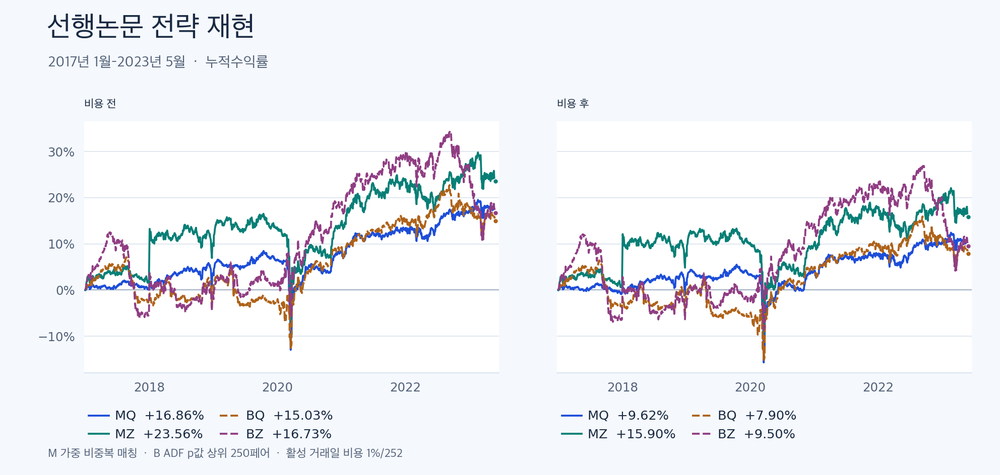
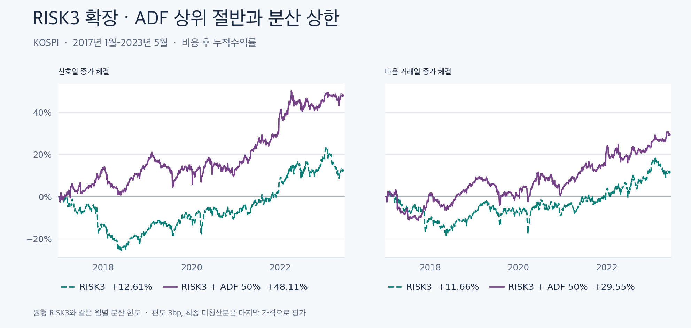

# 페어 트레이딩 논문 재현과 분산 제약 실험

2017년 1월부터 2023년 5월까지 77개월간 S&P 500과 코스피에 같은 전략을 적용했다. 미국은 1,613거래일, 한국은 1,577거래일이다. 수익은 일별 수익률을 복리로 누적했다. 연환산 수익률은 최종 자산배수를 거래일 수 기준으로 연 252거래일에 맞춰 복리 환산했다. 비용 전후 샤프는 각각의 일별 수익률을 기준으로 무위험수익률을 0으로 두고 일평균 수익률을 표본표준편차로 나눈 뒤 252의 제곱근을 곱했다.

## 1. 논문 재현 코드 수정

- 504거래일 로그가격 OLS 잔차에 시차 1의 ADF를 적용했다.
- M은 종목이 겹치지 않도록 `−ADF t통계량` 합을 최대화했다. B는 ADF p값이 가장 낮은 250페어를 선택했다.
- Z 신호와 달러 기준 헤지를 적용했다. 선정일 다음 거래일부터 수익을 집계하고 월말 중복을 제거했다. 거래비용은 매수·매도 각각의 체결금액에 편도 **3bp(0.03%)**를 적용했다.

비용 전 일수익률은 실제 보유분의 가격 손익을 거래 직전 순자산으로 나눈 값이다. 비용 후 일수익률은 여기서 당일 수수료를 같은 순자산으로 나눈 값을 차감한다. 수수료는 매수·매도 체결금액 합계의 0.03%이며, 진입·청산·방향 반전뿐 아니라 일별 회귀계수와 활성 페어 비중 변화에 따른 재조정에도 부과한다.

전일 보유금액의 가격 변동과 비용 차감 후 자산을 반영해 실제 거래금액을 계산한다. 서로 다른 페어에서 같은 종목을 반대 방향으로 거래해도 각 페어의 체결금액을 합산한다. 월말에는 보유분을 이월하고 최종 거래일 종가에 잔여 포지션 청산을 시도한다. 거래량이 있는 코스피의 체결 조건은 3절에 설명한다. S&P 500 원본에는 거래량이 없어 기존 가격 기반 체결을 적용하며, 가격이 누락된 날에는 직전 관측가를 사용한다.

| 전략 | 비용 전 누적수익률 | 비용 후 누적수익률 | 비용 전 연환산 수익률 | 비용 후 연환산 수익률 | 비용 전 샤프 | 비용 후 샤프 | 논문 비용 후 누적수익률 |
| --- | ---: | ---: | ---: | ---: | ---: | ---: | ---: |
| MZ | +23.56% | -4.62% | +3.36% | -0.74% | 0.42 | -0.04 | +66.34% |
| BZ | +16.73% | -12.05% | +2.45% | -1.99% | 0.30 | -0.16 | -13.40% |

논문 열은 원문의 비용 가정에 따른 참고값이므로 이번 결과와 비용 조건이 다르다. [논문 표 2·3](https://arxiv.org/html/2403.07998v1#S5.SS2) · [성과 대조](results/paper/metrics.csv)



## 2. 종목 중복 완화와 분산 상한

MZ는 아래 비교표의 기준 전략이다. CAP3와 RISK3는 MZ와 후보군·월별 페어 수를 일치시켰다. CAP3는 한 종목당 최대 3페어까지 허용하면서 공적분 점수 합을 최대화한다. RISK3의 분산 상한은 월말에 MZ 조합을 직전 252거래일에 적용해 얻은 비용 전 일별 수익률의 표본분산이다. 학습 기간은 현금에서 시작하며, 코스피의 학습 수익률에는 거래량에 따른 미체결과 보유분의 평가손익도 반영한다.

CAP3 해가 상한을 충족하면 바로 채택한다. 상한을 초과하면 MZ 조합에서 시작한다. 추가 후보는 MZ·CAP3 조합과 공적분 점수 상위 2K개 페어의 합집합이며, K는 그달 MZ 페어 수다. 점수가 높은 후보부터 살펴보고, 점수 합이 증가하고 종목별 상한을 지키는 제거 후보를 낮은 점수 순으로 최대 24개 검토한다. 학습 분산 상한을 만족하는 첫 교체를 채택한다. **전체 후보를 한 차례 훑어 채택된 교체가 0건이면 종료한다.** 각 교체에서 점수 합이 엄격히 증가하고 가능한 조합 수가 유한하므로 종료한다. 전역 최적성은 CAP3 해가 채택된 달에 확인된다. 월별 결과의 `swaps_per_pass`는 차례별 교체 건수이며, CAP3를 즉시 채택한 달에는 빈 목록이다.

| 전략 | 비용 전 누적수익률 | 비용 후 누적수익률 | 비용 전 연환산 수익률 | 비용 후 연환산 수익률 | 비용 전 샤프 | 비용 후 샤프 | 비용 후 연변동성 |
| --- | ---: | ---: | ---: | ---: | ---: | ---: | ---: |
| MZ | +23.56% | -4.62% | +3.36% | -0.74% | 0.42 | -0.04 | 8.80% |
| CAP3 | +34.93% | +2.72% | +4.79% | +0.42% | 0.53 | 0.09 | 9.69% |
| RISK3 | +39.85% | +6.45% | +5.38% | +0.98% | 0.59 | 0.15 | 9.66% |

CAP3의 월평균 공적분 점수는 MZ보다 12.40% 높았다. RISK3의 비용 후 누적수익률은 CAP3보다 3.73%p 높았다. RISK3는 77개월 모두 학습 분산 상한을 충족했다. S&P 500에서는 CAP3를 12개월에 바로 채택했고, 나머지 65개월은 교체 0건을 확인해 종료했다. 마지막 확인을 포함한 최장 탐색은 4차례였다. 세 전략 간 짝지은 블록 부트스트랩의 연율화 평균 일수익률 차이 95% 구간은 세 비교 모두 0을 포함했다. [성과표](results/paper_overlap/metrics.csv) · [월별 위험](results/paper_overlap/monthly.csv) · [비교 및 부트스트랩](results/paper_overlap/comparisons.csv)


## 3. 같은 모델의 코스피 성과

코스피 입력은 `KOSPI_최종가격데이터.csv`의 `adjusted_price` 열이다. 데이터에는 2013년 1월 2일부터 2023년 5월 31일까지 총 938개 종목이 있고, 첫 평가일 이전에 986거래일이 있다. 두 시장 모두 같은 실행 코드로 각 시장의 월말에 페어를 재선정하고 다음 거래일부터 수익을 집계했다. 첫 손익 귀속일은 미국이 2017년 1월 3일, 한국이 1월 2일이다. 수익률은 각 시장의 현지 통화 기준이다.

| 전략 | 비용 전 누적수익률 | 비용 후 누적수익률 | 비용 전 연환산 수익률 | 비용 후 연환산 수익률 | 비용 전 샤프 | 비용 후 샤프 |
| --- | ---: | ---: | ---: | ---: | ---: | ---: |
| MZ | +46.30% | +12.39% | +6.27% | +1.88% | 0.66 | 0.24 |
| BZ | +155.07% | +97.95% | +16.14% | +11.53% | 0.77 | 0.59 |
| CAP3 | +46.34% | +11.73% | +6.27% | +1.79% | 0.62 | 0.22 |
| RISK3 | +47.32% | +12.61% | +6.39% | +1.92% | 0.65 | 0.23 |

두 시장 모두 504거래일 회귀, 252거래일 분산 학습, 동일한 Z 신호·헤지비율·목표 비중과 편도 3bp를 사용한다. 코스피에서는 **주문을 내는 종가에 해당 종목의 거래량과 관측 가격이 모두 양수일 때** 체결한다. 거래량이 0이거나 누락된 날, 가격이 누락된 날, 상장폐지일 이후(당일 포함)에는 그 종목의 주문이 미체결된다. 거래량이 양수이고 가격이 유효한 반대편 종목은 목표 비중까지 전량 체결한다고 가정한다. 신호일 체결과 다음 거래일 체결 모두 실제 체결 예정일의 거래량을 확인한다. 일별 CSV의 날짜는 손익 귀속일이며, 당일 손익을 얻는 보유분의 재조정 시점은 직전 거래일 종가다.

미체결된 종목은 보유 주식 수를 유지하고 수수료를 부과하지 않는다. 매일 최신 목표 비중으로 다시 주문하며, 선정 목록에서 빠진 페어의 목표는 0이다. 정지 중에도 기존 보유분의 평가손익을 반영하고, 관측 가격이 사라지면 마지막 가격으로 평가한다. 최종일에도 팔거나 되살 수 없는 보유분은 각 실행 설정의 `terminal_holdings`에 기록한다. 최종 수익률은 그 잔여 보유분의 평가액을 포함한다. [두 시장 성과 CSV](results/market_comparison.csv) · [코스피 실행 설정과 최종 잔여 보유분](results/kospi/paper/run.json)

거래정지 종목을 보유한 채 다른 종목을 거래하면 실제 총노출(롱·숏 평가금액의 절댓값 합계)이 목표 비중을 넘을 수 있다. 코스피 BZ의 거래 직후 총노출은 최대 순자산의 2.29배였고, 최종일 미청산 롱·숏 평가금액의 절댓값 합계는 최종 순자산의 87.82%였다. 일별 결과에는 실제 총노출과 미체결 주문 건수를 함께 기록한다. 미체결 건수는 페어에 속한 각 종목의 주문 단위이며 같은 보유분의 청산을 여러 날 시도하면 매일 센다. [코스피 MZ·BZ 일별 결과](results/kospi/paper/daily.csv) · [코스피 분산 제약 전략 일별 결과](results/kospi/paper_overlap/daily.csv)

보유 주식 수와 현금 잔액으로 1,577거래일을 따로 검산했다. 코스피 다섯 전략 모두 거래량이 0이거나 누락된 날과 상장폐지일 이후(당일 포함)의 체결은 0건이었다. 2021년 8월 4일 종목 021820에 대한 MZ 주문 1건과 BZ 주문 41건도 모두 미체결이었다.

코스피에서는 77개월 모두 CAP3 해가 분산 상한을 초과해 교체 탐색을 수행했다. 2022년 9월 말 선정에서는 차례별로 224건, 5건, 4건, 2건, 0건을 교체했다. 네 번째 차례에서도 두 페어가 바뀌었고 다섯 번째 차례에서 종료했다. [코스피 월별 교체 횟수와 학습 분산](results/kospi/paper_overlap/monthly.csv)


[코스피 MZ·BZ 비용 전후 누적수익률 그래프](docs/kospi/paper_reproduction.png)

## 4. 코스피 RISK3 확장 모델 · ADF 상위 절반 + 분산 상한

코스피에서 원형 RISK3가 고른 페어 중 공적분 점수가 높은 절반에 자본을 집중하면 성과와 낙폭이 어떻게 달라지는지 살펴본다. 아래 표와 그래프는 **원형 RISK3와 확장형**을 같은 거래일·체결 조건에서 비교한다. 결과 파일에서 확장형의 식별자는 `RISK3_half_adf_budget`이다.

1. 매월 말 원형 RISK3의 선정 페어를 공적분 점수(ADF t통계량에 −1을 곱한 값)가 높은 순서로 정렬하고 상위 절반을 남긴다. 페어 수가 홀수이면 내림하고, 동점이면 두 종목코드 순으로 정한다. 원형의 종목당 최대 3페어 조건을 그대로 물려받는다.
2. 남은 페어에 기존 Z 신호와 헤지비율을 적용해 직전 252거래일의 비용 전 포트폴리오 수익률을 다시 계산한다. 매일 신호가 활성화된 페어끼리 비중을 다시 배분한 뒤 일별 수익률의 표본분산을 구한다.
3. 이 분산이 원형 RISK3의 월별 한도 이내이면 투자비율을 100%로 정한다. 한도를 넘으면 두 다리의 목표 비중에 같은 투자비율을 곱해, 미체결을 반영한 학습 수익률의 분산이 한도에 닿도록 비율을 낮춘다. 모든 주문이 정상 체결되면 이 비율은 한도 변동성을 상위 절반의 학습 변동성으로 나눈 값이다. 현금 수익률은 0%다.

분산 한도는 원형 RISK3의 월별 결과에 저장된 `risk_budget`을 승계한다. 원형에서 이 값은 그달 MZ 페어 조합의 직전 252거래일 비용 전 분산으로 정해진다. 코스피 확장형은 매월 179~196페어를 선정했고, 77개월 모두 투자비율을 줄였다. [월별 페어 수와 투자비율](results/kospi/risk3_adf_half/monthly.csv)

**신호일 종가 체결 성과** · 2017년 1월~2023년 5월, 편도 3bp

| 모델 | 비용 전 누적 | 비용 후 누적 | 비용 전 연환산 | 비용 후 연환산 | 비용 전 샤프 | 비용 후 샤프 | 비용 후 최대 낙폭 |
| --- | ---: | ---: | ---: | ---: | ---: | ---: | ---: |
| 원형 RISK3 | +47.32% | +12.61% | +6.39% | +1.92% | 0.65 | 0.23 | -25.69% |
| ADF 상위 절반 + 분산 상한 | +77.34% | +48.11% | +9.59% | +6.48% | 1.08 | 0.76 | -13.67% |

신호일 종가 기준 원형과 확장형의 비용 후 연환산 수익률은 각각 +1.92%, +6.48%였고, 최대 낙폭의 크기는 각각 25.69%, 13.67%였다. 분산 상한은 매월 선정일까지 관측한 수익률에 적용한다. 상위 50% 규칙은 이 평가기간에서 여러 후보와 함께 검토했으므로, 이후 기간의 성과는 별도 검증이 필요하다.

같은 목표 비중을 **다음 거래일 종가**에 체결하고 거래비용을 다시 계산하면, 비용 후 연환산 수익률은 원형 +1.78%, 확장형 +4.22%다. 두 체결 방식 모두 월 경계에서 보유분을 이월하며, 마지막 거래일에 체결 가능한 청산 주문에만 비용을 부과한다. [코스피 성과표](results/kospi/risk3_adf_half/metrics.csv)



## 재실행

Python 3.13에서 실행했다. S&P 500은 논문 재현과 RISK3 선정을 순서대로 실행한다.

```bash
python -m venv .venv
source .venv/bin/activate
python -m pip install -r requirements.txt
python fetch_prices.py
python reproduce.py --paper --workers 4
python reproduce.py --overlap --workers 4
```

코스피 실험은 RISK3 선정 후 ADF 상위 절반 확장형까지 실행한다. CSV의 `date,ticker,adjusted_price,volume`을 날짜와 6자리 종목코드로 정렬하고 `delisting_date`가 있으면 체결 시점에 적용한다. 세 단계 모두 같은 파일과 출력 경로를 사용한다. 저장된 코스피 RISK3 결과와 가격 입력 해시·체결 규칙·탐색 종료 조건이 일치하면 확장 단계만 실행할 수 있다.

```bash
python reproduce.py --paper --workers 4 --prices "/path/to/KOSPI_최종가격데이터.csv" --output-root results/kospi
python reproduce.py --overlap --workers 4 --prices "/path/to/KOSPI_최종가격데이터.csv" --output-root results/kospi
python reproduce.py --risk3-adf-half --workers 4 --prices "/path/to/KOSPI_최종가격데이터.csv" --output-root results/kospi
```

가격 다운로드는 원본 저장소의 고정 커밋을 사용하고 SHA-256을 확인한다. 같은 파일을 보유했다면 `python fetch_prices.py /path/to/spx_prices.parquet.gz`로 설치할 수 있다. [가격 출처와 해시](data/provenance.json) · [원본 MIT 고지](data/SOURCE_LICENSE.txt)

본문에 명시되지 않은 회귀 방향은 종목명 순으로 고정했다. Z는 잔차 표준편차와 진입 문턱 2를 사용했다. 미국 원본 가격 파일에서 당시 지수 구성 이력과 가격 조정 방식은 확인되지 않았다. CAP3는 전체 후보에서 최적해를 확인했고, RISK3는 분산 상한이 작동한 달에 제한된 교체 탐색을 사용했다.

두 시장의 성과표는 `python compare_markets.py`로 재생성한다. 한글 글꼴이 있는 환경에서 다음 명령으로 각 시장의 그래프를 그릴 수 있다.

```bash
python plot_results.py --output docs
python plot_results.py --results-root results/kospi --market KOSPI --output docs/kospi
```

거래비용 회계, 가격 입력 및 성과 지표 검증은 `python -m unittest discover -s tests -v`로 실행할 수 있다.
