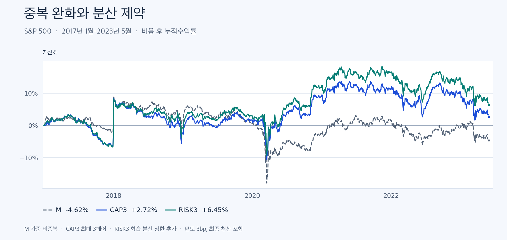
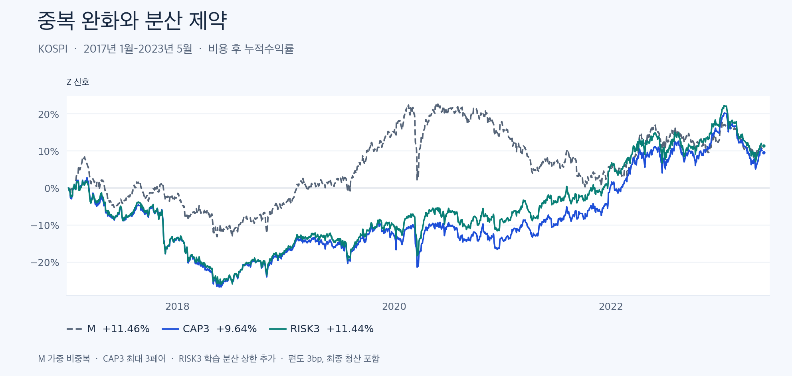

# 페어 트레이딩 논문 재현과 분산 제약 실험

2017년 1월부터 2023년 5월까지 77개월간 S&P 500과 코스피에 같은 전략을 적용했다. 미국은 1,613거래일, 한국은 1,577거래일이다. 수익은 일별 수익률을 복리로 누적했다. 연환산 수익률은 최종 자산배수를 거래일 수 기준으로 연 252거래일에 맞춰 복리 환산했다. 비용 전후 샤프는 각각의 일별 수익률을 기준으로 무위험수익률을 0으로 두고 일평균 수익률을 표본표준편차로 나눈 뒤 252의 제곱근을 곱했다.

## 1. 논문 재현 코드 수정

- 504거래일 로그가격 OLS 잔차에 시차 1의 ADF를 적용했다.
- M은 종목이 겹치지 않도록 `−ADF t통계량` 합을 최대화했다. B는 ADF p값이 가장 낮은 250페어를 선택했다.
- Z 신호와 달러 기준 헤지를 적용했다. 선정일 다음 거래일부터 수익을 집계하고 월말 중복을 제거했다. 거래비용은 매수·매도 각각의 체결금액에 편도 **3bp(0.03%)**를 적용했다.

매수·매도 체결금액의 합계에 0.0003을 곱한 뒤, 거래 직전 포트폴리오 자산으로 나누어 당일 수익률에서 차감한다. 진입·청산·방향 반전뿐 아니라 일별 회귀계수와 활성 페어 비중 변화에 따른 재조정에도 부과한다.

전일 보유금액의 가격 변동과 비용 차감 후 자산을 반영해 실제 거래금액을 계산하며, 각 페어의 두 종목을 별도로 집계한다. 서로 다른 페어에서 같은 종목을 반대 방향으로 거래해도 각 페어의 체결금액을 합산한다. 월이 바뀌어도 유지되는 페어의 보유분은 이월하고, 최종 거래일에는 잔여 포지션 청산 비용을 반영한다. 결측 가격의 평가와 체결 가격 추정은 기존 직전 관측가 사용 규칙을 따른다.

| 전략 | 비용 전 누적수익률 | 비용 후 누적수익률 | 비용 전 연환산 수익률 | 비용 후 연환산 수익률 | 비용 전 샤프 | 비용 후 샤프 | 논문 비용 후 누적수익률 |
| --- | ---: | ---: | ---: | ---: | ---: | ---: | ---: |
| MZ | +23.56% | -4.62% | +3.36% | -0.74% | 0.42 | -0.04 | +66.34% |
| BZ | +16.73% | -12.05% | +2.45% | -1.99% | 0.30 | -0.16 | -13.40% |

논문 열은 원문의 비용 가정에 따른 참고값이므로 이번 결과와 비용 조건이 다르다. [논문 표 2·3](https://arxiv.org/html/2403.07998v1#S5.SS2) · [성과 대조](results/paper/metrics.csv)


## 2. 종목 중복 완화와 분산 상한

MZ는 아래 비교표의 기준 전략이다. CAP3와 RISK3는 MZ와 후보군·월별 페어 수를 일치시켰다. CAP3는 한 종목당 최대 3페어까지 허용하면서 공적분 점수 합을 최대화했다. RISK3는 CAP3에 Z 신호의 최근 252거래일 M의 비용 전 일별 수익률 분산 상한을 추가했다.

| 전략 | 비용 전 누적수익률 | 비용 후 누적수익률 | 비용 전 연환산 수익률 | 비용 후 연환산 수익률 | 비용 전 샤프 | 비용 후 샤프 | 비용 후 연변동성 |
| --- | ---: | ---: | ---: | ---: | ---: | ---: | ---: |
| MZ | +23.56% | -4.62% | +3.36% | -0.74% | 0.42 | -0.04 | 8.80% |
| CAP3 | +34.93% | +2.72% | +4.79% | +0.42% | 0.53 | 0.09 | 9.69% |
| RISK3 | +39.85% | +6.45% | +5.38% | +0.98% | 0.59 | 0.15 | 9.66% |

CAP3의 월평균 공적분 점수는 MZ보다 12.40% 높았다. RISK3의 비용 후 누적수익률은 CAP3보다 3.73%p 높았다. RISK3는 77개월 모두 학습 분산 상한을 충족했다. 세 전략 간 짝지은 블록 부트스트랩의 연율화 평균 일수익률 차이 95% 구간은 세 비교 모두 0을 포함했다. [성과표](results/paper_overlap/metrics.csv) · [월별 위험](results/paper_overlap/monthly.csv) · [비교 및 부트스트랩](results/paper_overlap/comparisons.csv)



## 3. 같은 모델의 코스피 성과

코스피 입력은 `KOSPI_최종가격데이터.csv`의 `adjusted_price` 열이다. 데이터에는 2013년 1월 2일부터 2023년 5월 31일까지 총 938개 종목이 있고, 첫 평가일 이전에 986거래일이 있다. 두 시장 모두 같은 실행 코드로 각 시장의 월말에 페어를 재선정하고 다음 거래일부터 수익을 집계했다. 미국은 2017년 1월 3일, 한국은 1월 2일에 거래를 시작했다. 수익률은 각 시장의 현지 통화 기준이다.

| 전략 | 비용 전 누적수익률 | 비용 후 누적수익률 | 비용 전 연환산 수익률 | 비용 후 연환산 수익률 | 비용 전 샤프 | 비용 후 샤프 |
| --- | ---: | ---: | ---: | ---: | ---: | ---: |
| MZ | +45.28% | +11.46% | +6.15% | +1.75% | 0.66 | 0.23 |
| BZ | +129.65% | +74.40% | +14.21% | +9.29% | 0.70 | 0.51 |
| CAP3 | +43.83% | +9.64% | +5.98% | +1.48% | 0.60 | 0.19 |
| RISK3 | +46.06% | +11.44% | +6.24% | +1.75% | 0.64 | 0.22 |

두 시장 모두 504거래일 회귀, 252거래일 분산 학습, 동일한 Z 신호·헤지비율·자본배분, 편도 3bp 및 최종 청산 규칙을 사용했다. 코스피에서도 원본의 직전 관측가 평가·체결 가정을 적용했다. [두 시장 성과 CSV](results/market_comparison.csv) · [코스피 MZ·BZ 일별 수익률](results/kospi/paper/daily.csv) · [코스피 분산 제약 전략 일별 수익률](results/kospi/paper_overlap/daily.csv) · [코스피 실행 설정과 입력 파일 SHA-256](results/kospi/paper/run.json)



[코스피 MZ·BZ 비용 전후 누적수익률 그래프](docs/kospi/paper_reproduction.png)

## 재실행

Python 3.13에서 실행했다. 두 번째 실험은 첫 번째 실험의 `results/paper/` 결과를 기준으로 사용한다.

```bash
python -m venv .venv
source .venv/bin/activate
python -m pip install -r requirements.txt
python fetch_prices.py
python reproduce.py --paper --workers 4
python reproduce.py --overlap --workers 4
```

코스피 실험은 같은 두 명령에 원본 CSV 경로와 결과 디렉터리를 지정한다. CSV의 `date,ticker,adjusted_price` 열을 종목별 가격표로 펼치고 6자리 종목코드를 보존한다. 같은 가격 파일과 출력 경로를 두 단계에 지정한다.

```bash
python reproduce.py --paper --workers 4 --prices "/path/to/KOSPI_최종가격데이터.csv" --output-root results/kospi
python reproduce.py --overlap --workers 4 --prices "/path/to/KOSPI_최종가격데이터.csv" --output-root results/kospi
```

가격 다운로드는 원본 저장소의 고정 커밋을 사용하고 SHA-256을 확인한다. 같은 파일을 보유했다면 `python fetch_prices.py /path/to/spx_prices.parquet.gz`로 설치할 수 있다. [가격 출처와 해시](data/provenance.json) · [원본 MIT 고지](data/SOURCE_LICENSE.txt)

본문에 명시되지 않은 회귀 방향은 종목명 순으로 고정했다. Z는 잔차 표준편차와 진입 문턱 2를 사용했다. 미국 원본 가격 파일에서 당시 지수 구성 이력과 가격 조정 방식은 확인되지 않았다. CAP3는 전체 후보에서 최적해를 확인했고, RISK3는 분산 상한이 작동한 달에 제한된 교체 탐색을 사용했다.

두 시장의 성과표는 `python compare_markets.py`로 재생성한다. 한글 글꼴이 있는 환경에서 다음 명령으로 각 시장의 그래프를 그릴 수 있다.

```bash
python plot_results.py --output docs
python plot_results.py --results-root results/kospi --market KOSPI --output docs/kospi
```

거래비용 회계, 가격 입력 및 성과 지표 검증은 `python -m unittest discover -s tests -v`로 실행할 수 있다.
